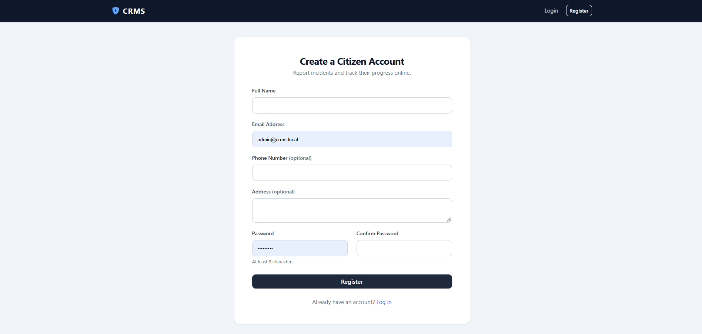
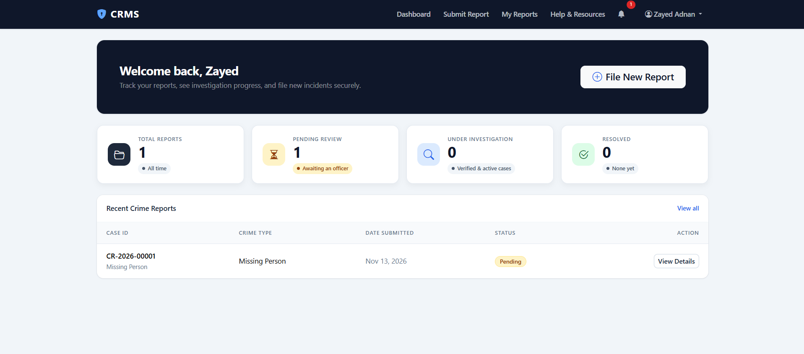
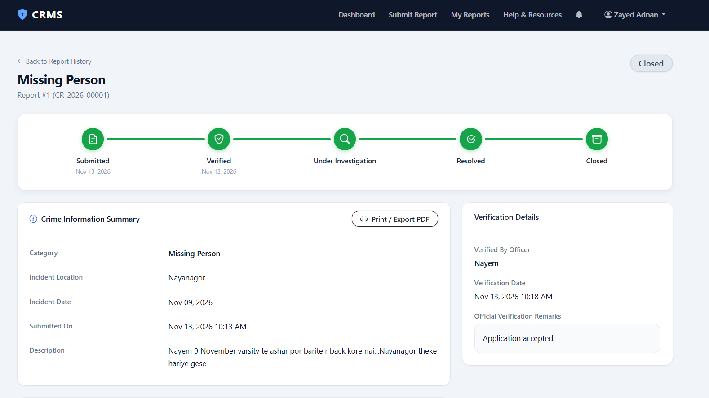
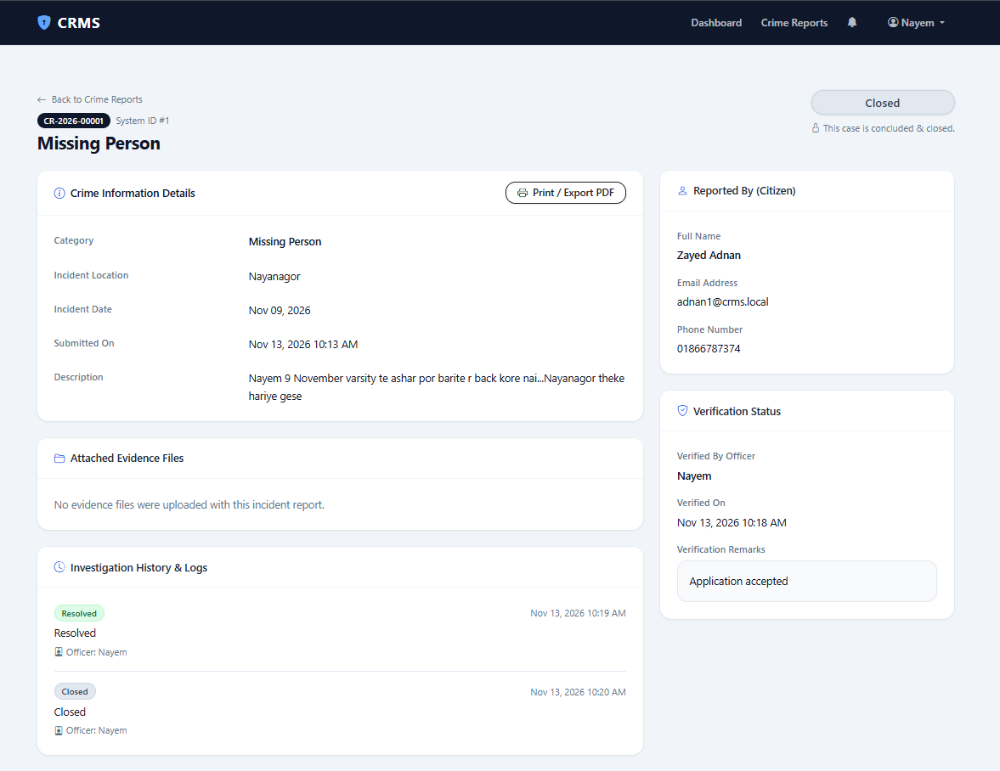
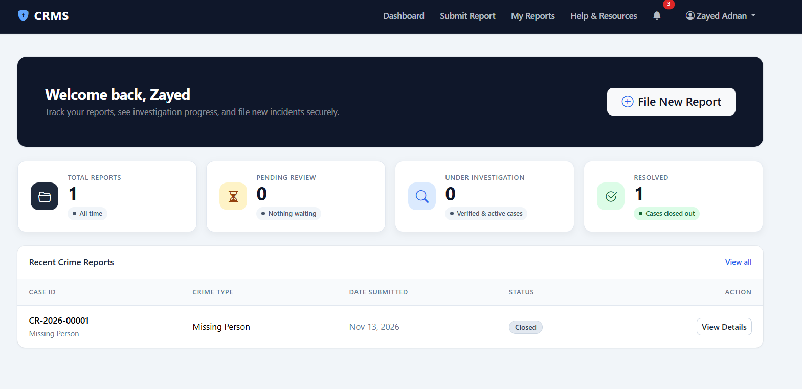
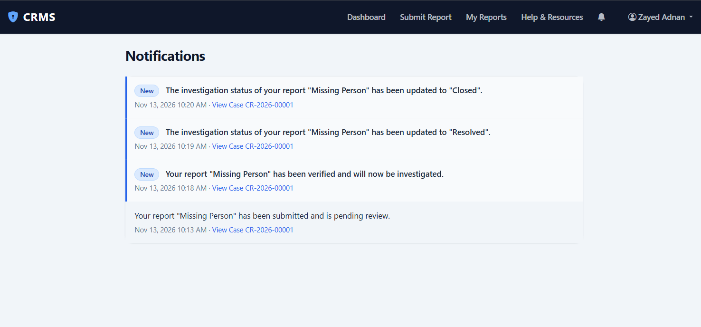
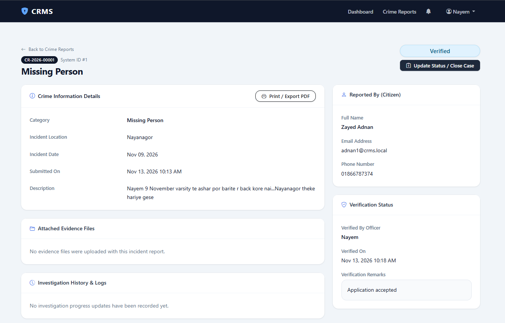
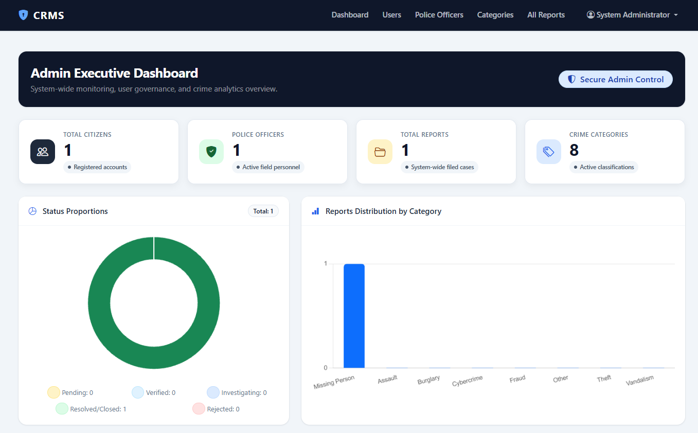
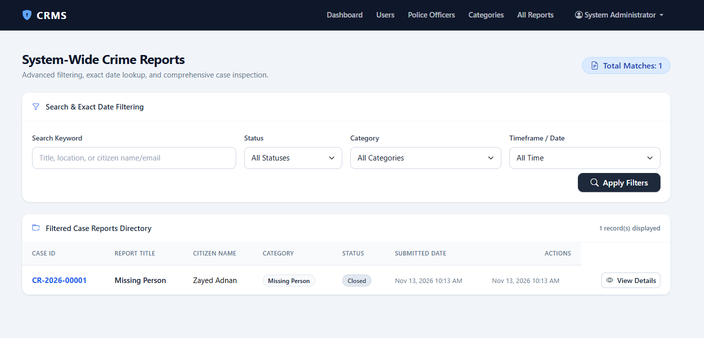

# Online Crime Reporting & Case Management System

A web-based crime reporting and case management system developed as a academic project.

The system allows citizens to submit crime reports and evidence, track report status, and receive notifications. Police officers can verify reports and manage investigations, while administrators can manage users, crime categories, reports, and system resources.

## Features

### Citizen
- Registration and Login
- Profile Management
- Submit Crime Report
- Upload Evidence
- Track Report Status
- View Report History
- Notifications
- Help & Resources

### Police Officer
- Login
- View and Search Crime Reports
- Verify or Reject Reports
- Manage Investigations
- Add Investigation Remarks
- Update Investigation Status
- Notifications

### Administrator
- Manage Users
- Manage Police Officers
- Manage Crime Categories
- View All Reports
- Dashboard Statistics

## Technologies Used

- PHP
- MySQL
- HTML5
- CSS3
- JavaScript
- Bootstrap
- XAMPP
- phpMyAdmin

## System Architecture

The system follows a three-tier architecture:

1. Presentation Layer
2. Application Layer
3. Data Layer

## Project Structure

online_crime_reporting/
│
├── index.php
├── login.php
├── register.php
├── logout.php
├── database.sql
│
├── config/
├── includes/
├── assets/
├── uploads/
│   └── evidence/
│
├── citizen/
├── police/
└── admin/

## 📸 System Screenshots & Interface Preview

### 1. User & Authentication Portals
* **User Registration:**
  

* **User Login:**
  

### 2. Citizen Portal & Case Tracking
* **Citizen Dashboard:**
  

* **Report Tracking Timeline:**
  

* **Closed Case View:**
  

* **Post-Closure Status:**
  

* **In-System Notifications:**
  

* **Help & Resources:**
  

### 3. Police Officer Portal
* **Officer Dashboard:**
  

* **Verified Section:**
  

* **Verify / Reject Triage Workflow:**
  

### 4. Administrator Portal
* **Admin Executive Dashboard:**
  

* **System-Wide Reports & Filtering:**
  